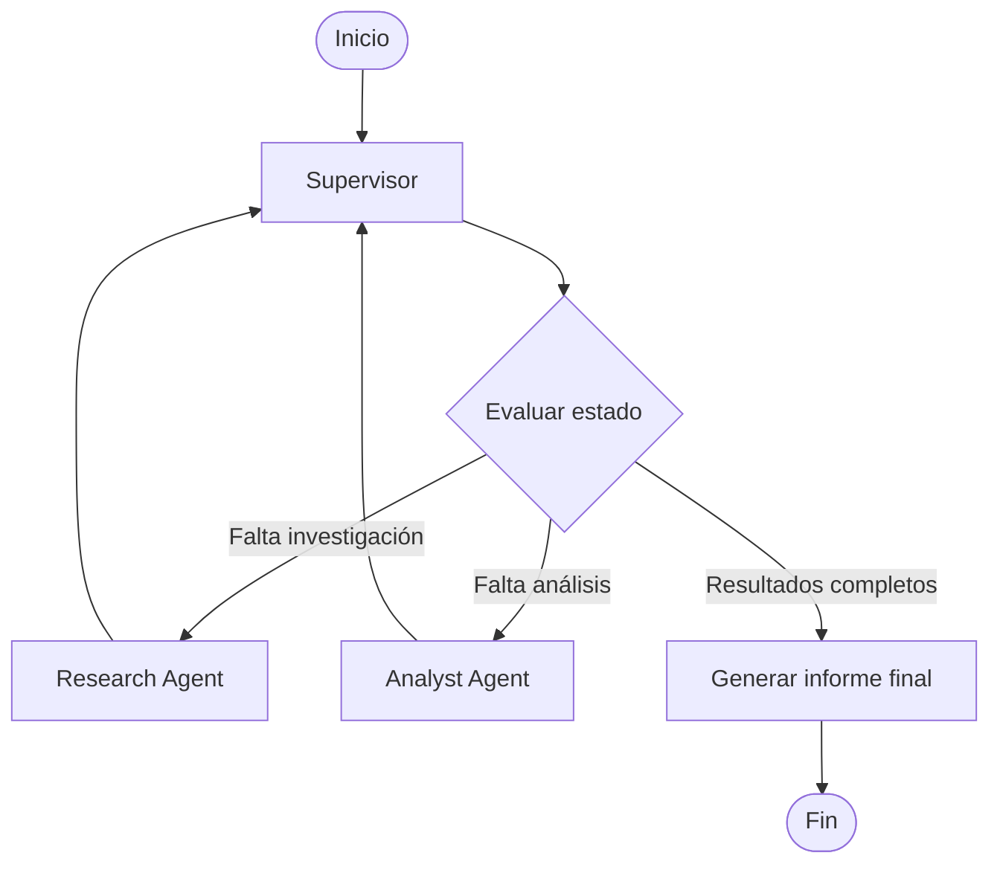

# Orquestador Multi-Agente de Investigación y Análisis

Prototipo de un sistema multi-agente desarrollado en Python y LangGraph, capaz de coordinar agentes especializados para investigar información, analizar resultados y generar un informe final mediante una arquitectura jerárquica.

## Objetivo del proyecto

Desarrollar un orquestador inteligente que distribuya tareas entre distintos agentes especializados. Un Supervisor central controla el flujo de ejecución, decide qué agente debe intervenir, valida los resultados y determina cuándo finalizar el proceso.

## Arquitectura

El sistema está compuesto por tres componentes principales:

### 1. Supervisor

Es el encargado de coordinar todo el flujo de trabajo.

Sus responsabilidades son:
- Recibir la consulta del usuario.
- Evaluar el estado compartido.
- Decidir qué agente debe ejecutarse.
- Delegar tareas de investigación y análisis.
- Validar los resultados recibidos.
- Controlar la cantidad de iteraciones.
- Finalizar el proceso cuando se completan las tareas.

### 2. Research Agent

Agente especializado en investigación y recuperación de información.

Funciones:
- Consultar una base de conocimiento local en formato JSON.
- Buscar coincidencias entre la consulta y los documentos disponibles.
- Calcular la relevancia de los resultados.
- Devolver los documentos encontrados al estado compartido.

### 3. Analyst Agent

Agente especializado en análisis y procesamiento de información.

Funciones:
- Recibir los documentos recuperados por Research Agent.
- Identificar información relacionada con beneficios y riesgos.
- Calcular indicadores sobre los documentos encontrados.
- Devolver los resultados al Supervisor.

## Diagrama de arquitectura



## Flujo de ejecución

1. El usuario ingresa una consulta.
2. El Supervisor recibe la solicitud y evalúa el estado del sistema.
3. Si todavía no existen resultados de investigación, delega la tarea en Research Agent.
4. Research Agent consulta la base de conocimiento y devuelve los documentos relevantes.
5. El Supervisor recibe los resultados y determina que necesita un análisis.
6. Analyst Agent procesa la información y calcula indicadores.
7. El Supervisor valida que ambos especialistas hayan completado sus tareas.
8. Se genera un informe final con la investigación y el análisis realizado.

## Estado compartido

El estado del sistema se define en `state.py` utilizando `TypedDict` y heredando de `MessagesState`.

Contiene los siguientes campos:

| Campo | Descripción |
|---|---|
| `messages` | Historial de mensajes |
| `user_query` | Consulta original del usuario |
| `research_results` | Documentos recuperados |
| `analysis_results` | Indicadores calculados |
| `next_agent` | Próximo paso del Supervisor |
| `iteration` | Contador de iteraciones |
| `max_iterations` | Límite de iteraciones |
| `validation` | Resultado de la validación |
| `final_answer` | Informe final |

Los agentes actualizan campos específicos del estado compartido, permitiendo intercambiar información sin sobrescribir los resultados de otros especialistas.

## Herramientas implementadas

### Búsqueda en base de conocimiento

La función `search_knowledge_base()` consulta el archivo `data/knowledge_base.json`.

Realiza una búsqueda mediante coincidencias de términos, calcula una puntuación de relevancia y devuelve los documentos más relacionados con la consulta.

### Análisis de información

La función `analyze_information()` procesa los documentos recuperados y calcula:

- Cantidad de documentos analizados.
- Documentos relacionados con beneficios.
- Documentos relacionados con riesgos.
- Porcentaje de cobertura de la base consultada.

La cobertura representa la proporción de documentos recuperados respecto de los cinco documentos disponibles en la base actual.

## Control de ejecución

El Supervisor utiliza rutas condicionales de LangGraph para decidir qué agente debe ejecutarse.

Además, el sistema cuenta con un contador de iteraciones y un límite máximo para evitar ciclos indefinidos.

Cada ejecución genera un registro en:

`traces/execution_trace.json`

La traza almacena la consulta, la fecha de ejecución, los nodos ejecutados, sus resultados y el informe final.

## Tecnologías utilizadas

- Python
- LangGraph
- TypedDict
- MessagesState
- JSON
- Pytest

## Estructura del proyecto

```text
pre-entrega-6/
│
├── agents/
│   ├── __init__.py
│   ├── research_agent.py
│   └── analyst_agent.py
│
├── data/
│   └── knowledge_base.json
│
├── tests/
│   ├── test_agents.py
│   └── test_graph.py
│
├── traces/
│   └── execution_trace.json
│
├── state.py
├── graph.py
├── main.py
├── requirements.txt
├── .env.example
├── .gitignore
└── README.md
```

## Instalación y configuración

### 1. Clonar el repositorio

```bash
git clone https://github.com/Lorenzogomezmartins/CoderHouse-Pre-entrega-6.git
cd CoderHouse-Pre-entrega-6
```

### 2. Crear un entorno virtual

```bash
python -m venv .venv
```

Activarlo en Windows PowerShell:

```powershell
.\.venv\Scripts\Activate.ps1
```

### 3. Instalar las dependencias

```bash
pip install -r requirements.txt
```

## Ejecución

Iniciar el orquestador:

```bash
python main.py
```

Ejemplo de consulta:

```text
Investiga los beneficios y riesgos de adoptar inteligencia artificial en una empresa y analiza la información disponible.
```

El sistema ejecutará automáticamente el flujo de investigación, análisis, validación y generación del informe final.

## Pruebas automáticas

El proyecto incluye pruebas desarrolladas con Pytest para verificar el funcionamiento de los componentes principales.

Se comprueba:

- Recuperación de documentos relevantes.
- Consultas sin coincidencias.
- Cálculo de indicadores.
- Ejecución completa del flujo multi-agente.

Para ejecutar las pruebas:

```bash
python -m pytest -v
```

**Resultado de las pruebas realizadas: 4 passed.**

## Resolución de conflictos entre agentes

La arquitectura utiliza responsabilidades diferenciadas para evitar conflictos durante la ejecución.

- Research Agent modifica `research_results`.
- Analyst Agent modifica `analysis_results`.
- Supervisor controla la delegación, las iteraciones y la validación.

El Supervisor centraliza las decisiones y garantiza que el informe final se genere una vez recibidos los resultados de ambos especialistas.

## Limitaciones y mejoras futuras

La versión actual utiliza una base de conocimiento local y no realiza búsquedas en Internet en tiempo real.

El análisis se basa en coincidencias de palabras e indicadores sencillos, por lo que sus resultados dependen de la información disponible.

Como posibles mejoras se plantea:

- Incorporar búsqueda web mediante herramientas externas.
- Integrar una base de datos vectorial para recuperación semántica.
- Incorporar modelos de lenguaje para mejorar la interpretación y síntesis.
- Agregar nuevos agentes especializados.
- Implementar mecanismos más avanzados de validación de resultados.

## Autor

Proyecto desarrollado como parte de la formación en Ingeniería de IA de Coderhouse.

**GitHub:** [Lorenzogomezmartins](https://github.com/Lorenzogomezmartins)

**Repositorio:** [CoderHouse - Pre-entrega 6](https://github.com/Lorenzogomezmartins/CoderHouse-Pre-entrega-6)
